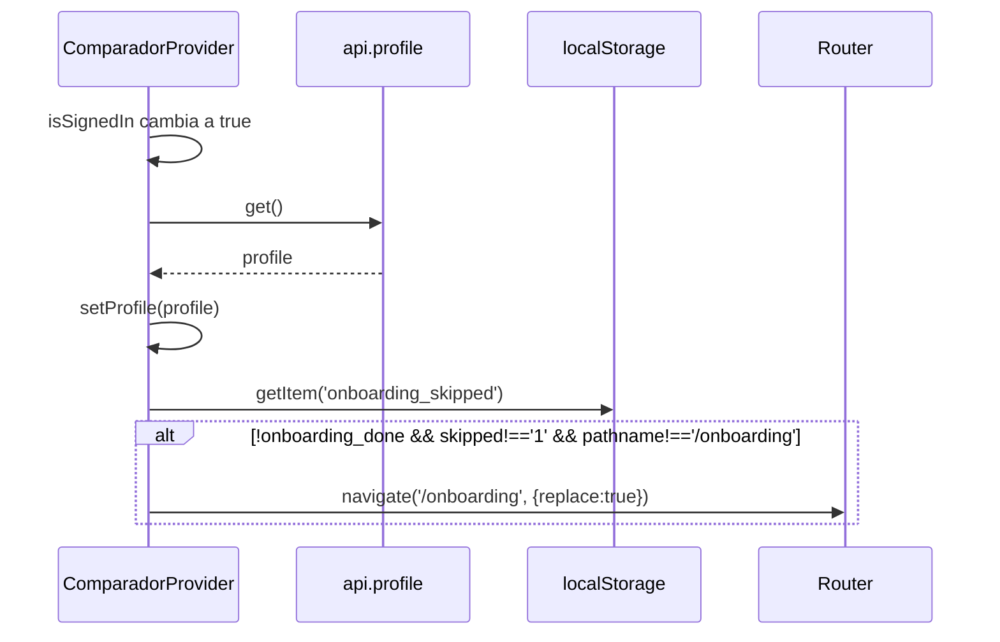

# Design: app-shell — COMPRO como host con módulos

> Specs: `specs/app-shell/spec.md` (H1–H7), `specs/comparador/spec.md` (C1–C6).
> Decisiones cerradas: rutas eager, providers siempre montados, `profile`/CP en el comparador, mover archivos en este cambio.
> Nota de tamaño: supera el presupuesto de 800 palabras del skill porque el orquestador pidió el mapa de archivos completo y los contratos definitivos.

## Enfoque técnico

Manifest tipado por módulo (`AppModule`) + `host/registry.ts` como única fuente. El host genera las `<Routes>`, compone los providers alrededor del layout y renderiza la nav top y bottom desde una sola `NavItem[]` por módulo. El estado ex-`AppShell` pasa tal cual a `ComparadorProvider`. Los wrappers de ruta leen el context y le pasan a las páginas las mismas props de hoy. La topología de anidamiento de rutas se mantiene igual (`/sign-in/*`, `/sign-up/*`, `/*` → layout → `<Routes>` internas), así que el comportamiento no cambia.

## Decisiones de arquitectura

| Tema | Opción elegida | Alternativa descartada | Por qué |
|---|---|---|---|
| Commit de movimiento | `git mv` + ajuste **sólo de especificadores de import** en el mismo commit, con typecheck y tests en verde | Commit de `git mv` puro (no compila: `App.tsx` y `AuthTokenBridge` importan `./pages/*`, `./api`) + un commit de fix | La spec C6 lo permite (MAY), `config.yaml` exige verde por tarea y los renames se siguen detectando con similitud ≥90% |
| UI compartida (`styles`, `EmptyState`, `layout/*`) | `host/ui/` (el módulo importa del host, que es la dirección permitida) | `src/shared/` | La propuesta ya la ubicó en el host y el header del host usa `FOCUS_RING`; una sola regla: `host ↛ modules` |
| Alias `@host/*` | No; se usan rutas relativas (`../../../host/ui/styles`) | Alias en tsconfig + vite + vitest | Evita tocar tres configs en un refactor; queda como mejora futura |
| Split de `api.ts` | `host/http.ts` (BASE, token getter, `req`, `reqOptional`); `modules/comparador/api.ts` (objeto `api`) | Dejar `api.ts` entero en el módulo | `AuthTokenBridge` (host) necesita `setTokenGetter` sin importar dominio |
| `types/api.ts` | Entero al módulo (`modules/comparador/types/api.ts`) | Partirlo | Es 100% dominio; `http.ts` no usa tipos de dominio |
| Lazy | El contrato acepta `LazyExoticComponent`; `routeElement()` envuelve en `<Suspense>` **sólo** si el componente es lazy (`$$typeof === Symbol.for('react.lazy')`). Hoy ninguna ruta es lazy, así que no se renderiza ningún `Suspense` | Agregar siempre `Suspense` / rechazar lazy en el tipo | Cumple H2 (eager + contrato listo) sin cambiar el DOM |
| Nav reactiva | `NavItemsProvider` del host encadena un `ModuleNavScope` por módulo (cada uno llama a **su** `useNav()` una sola vez y acumula). Top nav, bottom nav y `useHostLocation` leen el mismo context | Llamar `useNav()` en top y bottom por separado / bucle de hooks | Una sola lista real (H3), respeta las reglas de hooks y permite resolver `navItem` en H6 |
| Clerk dentro del módulo | El módulo sigue usando `useAuth`/`useClerk` de `@clerk/clerk-react` directamente | Fachada `useHostAuth()` | `CartContext.test` y el smoke test mockean `@clerk/clerk-react`; una fachada rompería esos mocks. Es candidata para un cambio futuro |
| Aislamiento | Test Vitest que escanea imports de `host/**` | `noRestrictedImports` de Biome | Biome 1.9 no matchea patrones de paths relativos, y CI no corre `lint` (sólo typecheck + test) |
| Context del comparador | Un solo `ComparadorContext`, sin `useMemo` (re-renderiza igual que las props de hoy) | Dividir state y dispatch | Es un refactor sin cambio de comportamiento; la optimización queda para después |

## Estructura final

```
frontend/src/
├── main.tsx  index.css  vite-env.d.ts         (sin cambios)
├── App.tsx                                    <AuthTokenBridge/> + <HostApp modules={registry}/>
├── test/App.smoke.test.tsx                    (sin cambios)
├── host/
│   ├── contract.ts        AppModule, ModuleRoute, NavItem, HostTool, ResolvedLocation
│   ├── registry.ts        export const registry = [comparador]   ← ÚNICO import a modules/
│   ├── HostApp.tsx        Routes raíz: sign-in/up + /* → ModuleProviders > NavItemsProvider > HostLayout
│   ├── HostLayout.tsx     header (marca, TopNav, spacer, headerActions, AccountMenu), main, overlays, BottomNav, HostToolsOutlet
│   ├── ModuleProviders.tsx  compone los Provider (el primer módulo queda afuera de todo)
│   ├── routing.tsx        flattenRoutes, joinPath, routeElement, isLazyComponent, ModuleRoutes
│   ├── nav/NavItemsProvider.tsx  ModuleNavScope (cadena), useNavGroups()
│   ├── nav/TopNav.tsx  nav/BottomNav.tsx  nav/labels.ts (topLabel)
│   ├── location.ts        resolveLocation (pura), useHostLocation
│   ├── tools.tsx          hostTools = [], HostToolsOutlet
│   ├── http.ts            setTokenGetter, req, reqOptional
│   ├── auth/              AuthTokenBridge, RequireAuth, AccountMenu, SignInPage, SignUpPage
│   ├── ui/                styles.ts, EmptyState(+test), layout/PageContainer, layout/TwoColumn
│   └── *.test.ts(x)       HostApp, location, labels, tools, isolation
└── modules/comparador/
    ├── index.ts           manifest `comparador: AppModule`
    ├── ComparadorProvider.tsx (+test)   CartProvider > ComparadorContext
    ├── useNav.ts          NavItem[] reactivos
    ├── routes.tsx         ExplorarRoute, InteresesRoute, OnboardingRoute
    ├── manifest.test.ts   rutas/auth vs H1 + resolveLocation('/compare')
    ├── api.ts  types/api.ts  supers.ts(+test)  handoff.ts(+test)  lib/zone.ts
    ├── contexts/CartContext.tsx(+test)
    ├── pages/             Cart(+test) Compare(+test) Explorar Intereses Onboarding Planner
    └── components/        …actuales + HeaderActions, CartButton, SyncPanel, LocationSlot
```

## Mapa de movimiento (commit 1)

| Origen (`frontend/src/`) | Destino |
|---|---|
| `api.ts` | `modules/comparador/api.ts` |
| `types/api.ts` | `modules/comparador/types/api.ts` |
| `supers.ts`, `supers.test.ts`, `handoff.ts`, `handoff.test.ts` | `modules/comparador/` (mismo nombre) |
| `lib/zone.ts` | `modules/comparador/lib/zone.ts` |
| `contexts/CartContext.tsx`, `.test.tsx` | `modules/comparador/contexts/` |
| `pages/{Cart,Cart.test,Compare,Compare.test,Explorar,Intereses,Onboarding,Planner}.tsx` | `modules/comparador/pages/` |
| `components/{AddToCartButton,CartDrawer,FreqModal,GroupedCard,GroupedCard.test,LocationSelector,ProductCard,ProductImage,PromoPanel,RecommendationBanner}.tsx` | `modules/comparador/components/` |
| `components/compare/*`, `components/onboarding/*` | `modules/comparador/components/compare/*`, `.../onboarding/*` |
| `components/AuthTokenBridge.tsx` | `host/auth/AuthTokenBridge.tsx` |
| `pages/SignInPage.tsx`, `pages/SignUpPage.tsx` | `host/auth/` |
| `styles.ts` | `host/ui/styles.ts` |
| `components/EmptyState.tsx`, `.test.tsx` | `host/ui/` |
| `components/layout/{PageContainer,TwoColumn}.tsx` | `host/ui/layout/` |
| `App.tsx`, `main.tsx`, `index.css`, `vite-env.d.ts`, `test/App.smoke.test.tsx` | se quedan |

**Únicos cambios de contenido permitidos en el commit 1 (especificadores):**
- `App.tsx`: `./api` → `./modules/comparador/api`, `./pages/X` → `./modules/comparador/pages/X` o `./host/auth/X`, `./components/...` → la nueva ubicación, `./styles` → `./host/ui/styles`, `./types/api` → `./modules/comparador/types/api`.
- `host/auth/AuthTokenBridge.tsx`: `../api` → `../../modules/comparador/api` (es una violación transitoria que se corrige en el commit 2).
- `pages/{Cart,Compare,Explorar,Intereses,Planner}`: `../styles`, `../components/EmptyState` y `../components/layout/*` pasan a apuntar a `../../../host/ui/...`.
- `components/{CartDrawer,PromoPanel}`: `../styles` → `../../../host/ui/styles`; en `CartDrawer`, `./EmptyState` → `../../../host/ui/EmptyState`.
- `components/compare/CompareView`: `../layout/TwoColumn` → `../../../../host/ui/layout/TwoColumn`.
- Los `vi.mock('../api')`, `vi.mock('../contexts/CartContext')` y `vi.mock('./AddToCartButton')` **no cambian**, porque la topología relativa se preserva.

Verificación: `git show -M --stat HEAD` muestra sólo renames más `App.tsx` como M, y `git show -M HEAD | rg '^[+-][^+-]' | rg -v "from '|import\('"` devuelve vacío.

## Contratos (`host/contract.ts`)

```ts
import type { ComponentType, LazyExoticComponent, ReactNode } from 'react';

export type RouteComponent = ComponentType | LazyExoticComponent<ComponentType>;

export interface ModuleRoute {
  id: string;                         // único dentro del módulo: 'explorar'
  path: string;                       // relativo a basePath; '' = índice
  component: RouteComponent;          // sin props: los wrappers leen el context
  auth: 'public' | 'required';        // obligatorio: el gating siempre es explícito
  title: string;                      // para resolveLocation / herramientas
}

export interface NavItem {
  id: string;
  to: string;                         // puede llevar search: '/?q=leche'
  label: string;                      // texto base: 'Intereses'
  icon?: string;                      // bottom: siempre en <span aria-hidden>; top: sólo si iconInTop
  iconInTop?: boolean;                // Comparar → top '📊 Comparar'
  badge?: number;                     // definido ⇒ contador en top; NO se muestra en bottom
  end?: boolean;
}

export interface AppModule {
  id: string;
  label: string;
  basePath: string;                   // '/' para el comparador
  routes: readonly ModuleRoute[];
  Provider?: ComponentType<{ children: ReactNode }>;
  useNav?: () => NavItem[];
  slots?: { headerActions?: ComponentType; overlays?: ComponentType };
}

export interface ResolvedLocation {
  module: AppModule;
  route: ModuleRoute;
  fullPath: string;
  params: Record<string, string | undefined>;
  navItem?: NavItem;                  // sólo vía useHostLocation (la nav es reactiva)
}

export interface HostTool { id: string; enabled: boolean; Component: ComponentType }
```

**Texto idéntico (H3/C2)**: `nav/labels.ts` concentra el formato y tiene un test unitario.
```ts
export const topLabel = (i: NavItem) =>
  (i.iconInTop && i.icon ? `${i.icon} ` : '') +
  (i.badge === undefined ? i.label : `${i.label} ${i.badge ? `(${i.badge})` : ''}`);
```
Reproduce el template actual al carácter, incluido `'Intereses '` con espacio final cuando n=0. La bottom renderiza `<span className="text-lg leading-none" aria-hidden="true">{icon}</span>{label}` igual que hoy. Las clases de `NavLink` se copian textuales.

`useNav()` del comparador devuelve:
`explorar {to: explorarTo.current, label:'Explorar', icon:'🔍', end:true}`, `intereses {badge: interests.length, icon:'❤️'}`, `planner {badge: shopping.length, icon:'📋'}` y, sólo si `profile?.onboarding_done`, `compare {label:'Comparar', icon:'📊', iconInTop:true}`. Llama a `useLocation()` para re-renderizar en cada navegación, con el mismo timing que el ref actual.

## Generación de rutas, auth y layout

```
<Routes>                                         (HostApp)
  /sign-in/*  → <SignInPage/>                    (host/auth)
  /sign-up/*  → <SignUpPage/>
  /*          → <ModuleProviders>                (Provider de TODOS los módulos, H4)
                  <NavItemsProvider>             (sin DOM)
                    <HostLayout>
                      <nav "Principal"> 🛒 COMPRO · <TopNav/> · spacer · headerActions[] · <AccountMenu/>
                      <main> <ModuleRoutes/>     (Routes internas: joinPath(basePath, path))
                      overlays[]  (CartDrawer)
                      <nav "Navegación inferior"> <BottomNav/>
                      <HostToolsOutlet/>         (vacío → null)
```

- `routeElement(r)`: `<C/>`, envuelto en `<RequireAuth>` si `r.auth === 'required'`, y en `<Suspense fallback={null}>` sólo si es lazy. `RequireAuth` es el mismo de hoy (`SignedIn` / `SignedOut` + `RedirectToSignIn`).
- `joinPath('/', '')` → `'/'`; `joinPath('/', 'intereses')` → `'/intereses'`. No hay ruta `*`: una URL desconocida deja `<main>` vacío, igual que hoy.
- `HostApp` recibe `modules` por props. Así los tests inyectan módulos falsos y `App.tsx` le pasa `registry`.

## ComparadorProvider

`ComparadorProvider = ({children}) => <CartProvider><ComparadorStateProvider>{children}</ComparadorStateProvider></CartProvider>`.

Migra **literal** desde `AppShell`:

| Pieza | Detalle |
|---|---|
| Estado | `interests`, `shopping`, `syncStatus`, `enrichStatus`, `enrichDone`, `promos`, `profile` (`undefined` = no cargado) |
| Refs | `enrichSeenRunning`, `explorarTo` (más el effect sobre `location` que lo actualiza cuando `pathname === '/'`) |
| Efectos | carga pública una sola vez al montar (sync, enrich, promos); carga de usuario según `isSignedIn` (al cerrar sesión limpia y deja `profile` en `undefined`); polling de sync y de enrich cada 3 s con `clearInterval` en el cleanup (C5); el `setTimeout` de 8 s de `enrichDone` queda igual |
| Acciones | `toggleInterest`, `addToShopping` (sin sesión → `navigate('/sign-in')`), `setProfile` |
| Derivados | `shoppingIds` |
| Hook | `useComparador()` (lanza un error si se usa fuera del provider) |



**Wrappers** (`routes.tsx`): `ExplorarRoute` (las 7 props), `InteresesRoute` (las 4 props), `OnboardingRoute` (`onComplete = p => { setProfile(p); navigate('/planner', {replace:true}) }`). `Planner`, `Cart` y `Compare` van directo.

**Slots**:
- `headerActions = HeaderActions`, que renderiza en este orden un fragmento con `CartButton` (lo extraído de `App`, con `useCart`), `LocationSlot` (`<LocationSelector location={profile?.postal_code ?? null} onSaved={setProfile}/>`) y `SyncPanel` (movido literal, recibe `syncStatus`).
- `overlays = CartDrawer`.

## resolveLocation / useHostLocation / HostToolsOutlet

- `resolveLocation(pathname, modules)` es pura. Arma `RouteObject[]` (`{ id: '<mod>:<route>', path: fullPath }`) y usa `matchRoutes` de react-router, que aplica el **mismo ranking** que `<Routes>`. Devuelve `null` si nada matchea (`/sign-in/...` y `/no-existe` no están en el registry).
- `useHostLocation()` resuelve `useLocation().pathname` contra `registry` y completa `navItem` buscando, entre los items de ese módulo en `NavItemsContext`, el que tenga `matchPath(fullPath, new URL(to, 'http://x').pathname)`. Sólo funciona dentro del layout, que es donde se monta `HostToolsOutlet`.
- `tools.tsx`: `export const hostTools: HostTool[] = []`. `HostToolsOutlet` hace `hostTools.filter(t => t.enabled)` y devuelve `null` si la lista queda vacía (H7: DOM idéntico).

## Test de aislamiento (H5)

`host/isolation.test.ts`:
1. `import.meta.glob('./**/*.{ts,tsx}', { query: '?raw', import: 'default', eager: true })` (los tipos vienen de `vite/client`; si da problemas, el fallback es `node:fs` con `readdirSync(recursive)`).
2. Una función pura `findViolations(files: Record<string,string>)` extrae los especificadores (`from '…'`, `import('…')`, `import '…'`), los resuelve con `path.posix` respecto de `src/host/<file>` y marca los que caen en `src/modules/` (o contienen `modules/` si se usa alias) cuando el archivo no es `registry.ts`.
3. Hay dos casos de test: el árbol real tiene que dar `[]`, y un mapa sintético `{ './x.ts': "import { api } from '../modules/comparador/api'" }` tiene que devolver `['x.ts']`. Ese segundo caso cubre el escenario "Violación detectada", que nombra el archivo.

## Estrategia de tests

| Capa | Qué | Cómo |
|---|---|---|
| Existentes | Smoke, Cart, Compare, CartContext, GroupedCard, EmptyState, supers, handoff | Sin tocar asserts; los mocks resuelven por la topología preservada |
| Unit host | `topLabel` (incluye el espacio final), `joinPath`, `resolveLocation` con módulos falsos (más específico, `null`), `HostToolsOutlet` (lista vacía y tool deshabilitada) | Vitest puro / RTL |
| Integración host | `HostApp` con módulo falso `/demo` (H2), módulo sin `useNav` (H3), ruta `required` con `SignedOut` mockeado → `RedirectToSignIn` (H1), top y bottom con los mismos `to` (H3), slot que lee el context del Provider (H4), ruta desconocida → `main` vacío | `MemoryRouter initialEntries` + mock de Clerk como en el smoke |
| Comparador | `manifest.test.ts`: tabla de paths y `auth` (C1) + `resolveLocation('/compare', [comparador])` (H6). `ComparadorProvider.test.tsx`: redirige con `replace`, respeta el skip, no redirige si ya estás en `/onboarding` (C3); Comparar condicionado y contadores (C2); Explorar recuerda `?q=` (C2); `vi.useFakeTimers` + desmontar → `vi.getTimerCount() === 0` (C5); acción sin sesión → `/sign-in` (C4) | Mock de `'./api'` y de Clerk, igual que el patrón existente |
| Aislamiento | H5 | ver arriba |

## Orden de commits (todos con typecheck y test en verde)

1. `refactor(frontend): mover dominio a modules/comparador y UI compartida a host` (`git mv` + especificadores, ver el mapa).
2. `refactor(frontend): extraer núcleo HTTP a host/http`: crea `http.ts`, `modules/comparador/api.ts` importa `req`/`reqOptional` de `../../host/http`, y `AuthTokenBridge` importa de `../http`.
3. `refactor(frontend): contrato AppModule y HostApp genérico`: `contract`, `routing`, `nav/*`, `location`, `tools`, `auth/{RequireAuth,AccountMenu}`, `HostLayout`, `HostApp` + tests con módulos falsos + test de aislamiento. Todavía no está cableado: `App.tsx` no cambia.
4. `refactor(frontend): comparador como módulo del host`: `ComparadorProvider`, `useNav`, `routes.tsx`, slots, manifest, `registry.ts`, `App.tsx` reducido (se elimina `AppShell`, `SyncPanel` y `RequireAuth` de `App`).
5. `test(frontend): cobertura de ComparadorProvider y manifest`.

## Migración / rollout

No requiere migración: no toca backend, DB ni URLs. El rollback es un `git revert` del squash, o revertir la fase rota mientras se trabaja.

## Preguntas abiertas

- [ ] Ninguna bloqueante. Hay que sincronizar con la spec: H6 dice que `resolveLocation(pathname)` devuelve `navItem?`. En el diseño, la versión pura recibe `modules` y nunca completa `navItem`; lo hace sólo `useHostLocation`. Es compatible porque el campo es opcional.
